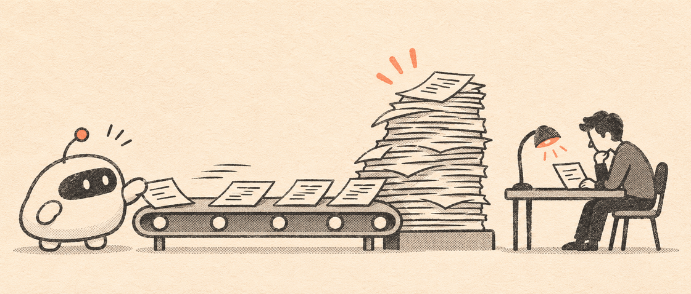
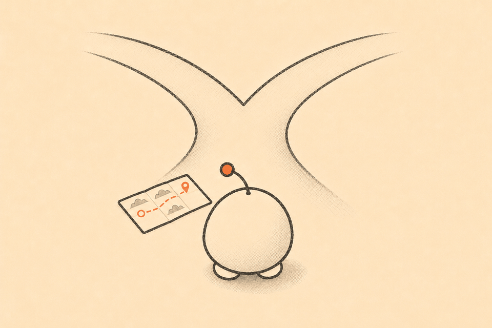
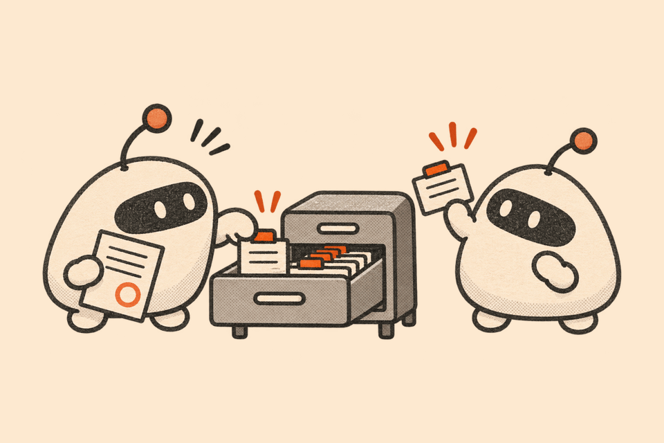

# Architectural Memory

*November 10, 2026*


## The Platform

I started building a shared application platform in late 2021 for one of Canada's largest telecommunications and media groups. Today it supports ten independently deployed web applications and four TV applications for high-traffic news, video, and radio services.

The products share SDKs, components, tooling, and a common architecture in a modular monorepo. A decision in shared code can affect several products at once.

I'm the platform architect, and I still work on it as a senior engineer. I ship features and work with every developer on the team, from shaping a change through implementation and review.

## Code Outran Review

I haven't written a line of code by hand since December 2025. Coding agents now write all the code across the platform.

Around the release of [Claude Opus 4.5](https://www.anthropic.com/news/claude-opus-4-5) and [GPT-5.2](https://developers.openai.com/cookbook/examples/gpt-5/gpt-5-2_prompting_guide), agents got reliable enough to implement a change from start to finish. Over the next few months, more of the team started using them.

I define the problem and the constraints, then decide where the behavior belongs and how it should fit with the rest of the system. From there I steer the agent through the implementation and check the result.

A developer working with an agent can now produce changes faster than a senior engineer can review them carefully. We started producing a lot more code. I still had the same amount of time to review it and the same responsibility for keeping the architecture sound and the code maintainable.

In March 2026, the *Financial Times* reported that, after a series of major incidents, Amazon planned to require senior sign-off on AI-assisted changes from junior and mid-level engineers ([Financial Times report](https://www.ft.com/content/7cab4ec7-4712-4137-b602-119a44f771de)). Amazon disputed both the link to AI-written code and the claim of a new approval requirement ([Amazon's response](https://www.aboutamazon.com/news/company-news/amazon-outage-ai-financial-times-correction)).

A sign-off rule like that would leave the extra changes waiting for a senior engineer. A change can look perfectly reasonable on its own and still make the codebase a little harder to work in. I used to catch that kind of slop one pull request at a time.



## The Team Was the Memory

We already had types, schemas, tests, and CI before we started using agents. Code review was the only practical place we had to enforce the architectural rules that lived in our heads.

When a change added a capability, we'd ask which module should own it, including its source of truth and lifecycle. Was it something we should share, or should the application own its final form? We'd already settled how the modules could talk to each other. Applications used shared packages only through public entry points, and dependencies ran from product applications toward shared packages.

When I found a violation, I explained the rule. Then I explained it again on another pull request. Over time I left those comments less often because my colleagues knew where the boundaries were and why we'd drawn them.

The repository showed where things lived. The people on the team could tell you why, and new contributors learned that history in code review.

## Review Agents Shared the Blind Spot

When the pull requests started piling up, I tried to “fight agents with agents.” I had agents review pull requests before I looked at them. They found bugs and edge cases and checked whether the changes were consistent with the rest of the code.

Both agents could see where code lived. The reasons behind our decisions about ownership, lifecycle, and dependency direction were still in our heads. One agent could put a behavior in the nearest convenient module, expose an internal API, or add a dependency in the wrong direction. The other could approve any of those changes, making it easier for the same mistakes to spread.

My colleagues remembered those review conversations and applied what they'd learned to the next pull request. Every new agent session began with the same architectural amnesia.


## Make the Repository Remember

We'd worked out those rules over years of conversations and code reviews. Every coding agent starts with the repository, so we began writing down the rules and the reasons behind them next to the code. We automated the checks we could. I call that Architectural Memory.


An agent can trace a call and see which module owns a behavior today. We use `AGENTS.md` to give it the reasoning it needs for the next decision. If two apps keep similar behavior separate because it changes on different release cycles, that reason helps the agent judge whether to move it into a shared package.

For constraints we can check mechanically in our JavaScript and TypeScript source, we write custom ESLint rules. They enforce ownership boundaries and dependency direction, and can restrict imports to a package's public entry points. When a check fails, the error names the supported path and explains why it's there.

We keep one rule per file. That makes each check easy to review and lets us add or remove rules independently.



## Where the Rules Live

Our monorepo already gave us a place to put each rule. Applications, shared packages, reusable components, and tooling lived in separate parts of the tree. Those boundaries showed who owned a behavior, which code changed together, and which way dependencies could go.

The root `AGENTS.md` holds rules for the whole repository. Files under `apps/`, `packages/`, or in an individual package cover that part of the tree. Our agents pick up instructions along the path to the code. If two rules conflict, the one closest to the code wins.

```text
AGENTS.md
apps/
  AGENTS.md
packages/
  AGENTS.md
  billing/
    AGENTS.md
  design-system/
    AGENTS.md
```

For a change in `packages/billing/`, an agent picks up the root, `packages/`, and `billing/` rules. The design system's guidance stays in its own package.

This depends on having clear modules in the first place. If presentation, business rules, and infrastructure all live in the same large files, instructions have to cover more code and lint rules need more exceptions.

## When a Decision Becomes a Rule

Boris Cherny, who created Claude Code at Anthropic, used to tally recurring review comments in a spreadsheet. After he'd seen the same problem three or four times, he'd write a lint rule for it. Now, when he spots something “lintable,” he asks Claude Code to [write the rule in that pull request](https://www.youtube.com/watch?v=julbw1JuAz0&t=2718s).

With an agent, we can get a new rule working during the review that exposed the problem. A decision worth recording can also come out of planning, design, or implementation. Before I write it down, I ask what the code leaves unexplained and which future decision that explanation would change.

1. Decide whether the finding will matter beyond the current change.
2. Record the decision and its reason in the narrowest relevant `AGENTS.md` as part of the same change.
3. Add a lint rule if the tool can spot the violation in the code.
4. Fix existing violations before turning on the rule. Check the result in the same pull request.



## When a Rule Goes Stale

We write down decisions we expect to govern future changes. When a rule outlives the design, it can flag valid changes and send developers and agents looking for workarounds.

I try to keep lint rules narrow, explain how to fix a violation, and write down any exceptions. The reasoning needs to be clear enough for the team to question a rule and change it when the design changes.

## What Changed in Review

Since we started writing down these rules, agent-written changes have followed the platform's architecture more consistently. The agent writing the code and the one reviewing it start with the same instructions. ESLint catches the violations it can check before anyone reviews the pull request.

When we settle an architectural question, I put our reasoning where the next agent will look. I want to make that decision once and spend the next review on something new.
